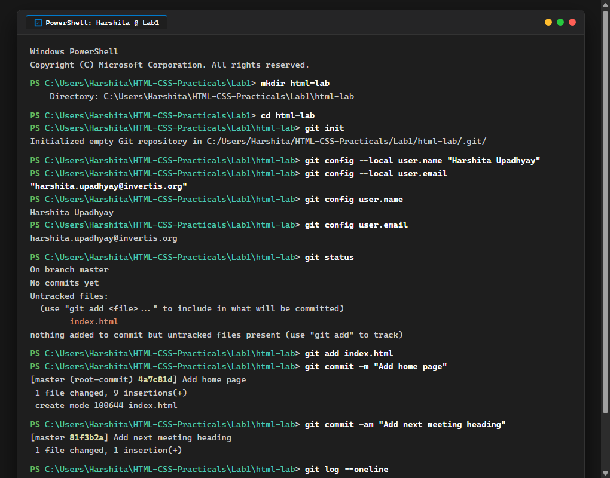

# EXPERIMENT NO. 01

## 1. Experiment Title
Starting a Git Repository

## 2. Aim
Start a Git repository for your lab folder and save your work with commits.

## 3. Software / Tools Required
- Operating System: Windows 10/11
- Tools: Git, PowerShell / Terminal, VS Code

## 4. Theory
Git is a version control system that tracks changes in files over time.
- `git init`: Creates a new Git repository in a folder.
- `git config`: Sets the author name and email for commits.
- `git status`: Shows the state of working files (untracked, modified, or staged).
- `git add`: Adds files to the staging area.
- `git commit`: Saves the staged snapshot with a message.
- `git log`: Shows the commit history.

## 5. Algorithm / Procedure
1. Create a folder named `html-lab` and navigate into it.
2. Initialize Git using `git init`.
3. Set your local name and email with `git config --local`.
4. Create `index.html` with an `<h1>` heading.
5. Check status with `git status`, stage it with `git add index.html`, and commit with message "Add home page".
6. Add an `<h2>` heading below the first one and commit with message "Add next meeting heading".
7. View commits using `git log --oneline`.

## 6. Program / Queries / Commands
```bash
# 1. Initialize and configure
mkdir html-lab
cd html-lab
git init
git config --local user.name "Harshita Upadhyay"
git config --local user.email "harshita.upadhyay@invertis.org"

# 2. Add and commit home page
git status
git add index.html
git commit -m "Add home page"

# 3. Add second heading and commit
git commit -am "Add next meeting heading"
git log --oneline
```

## 7. Input
Folder: html-lab, File: index.html with h1 and h2 headings.

## 8. Output
Terminal output showing git initialization, user configuration, and the two recorded commits.



## 9. Result
The Git repository was successfully created and two commits were saved in the history.

## 10. Viva-Voce Questions
1. **What is the purpose of git init?**  
   *Answer:* It initializes a new empty Git repository and creates a hidden .git folder.

2. **What is the difference between git add and git commit?**  
   *Answer:* git add moves changes to the staging area, while git commit permanently saves those changes to the repository history.

3. **What does git log --oneline do?**  
   *Answer:* It displays the commit history with each commit shown on a single line with its short hash and message.
