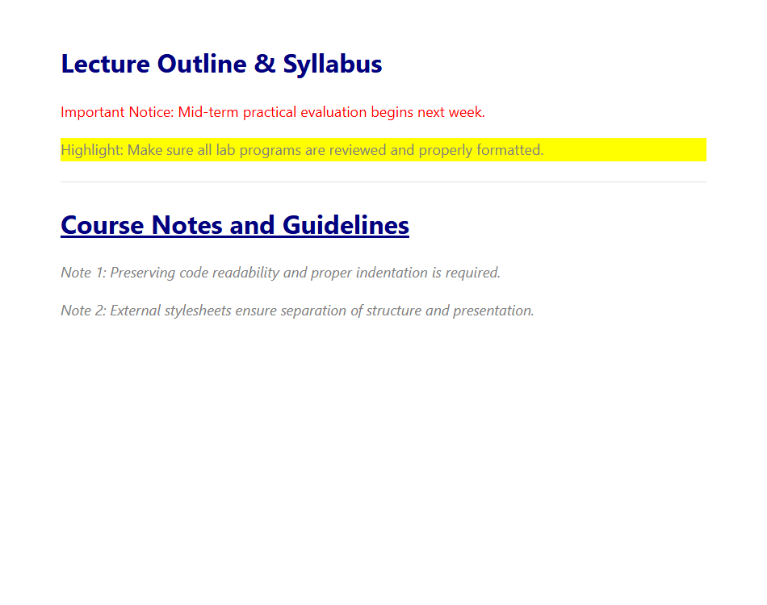

# EXPERIMENT NO. 10

## 1. Experiment Title
CSS Fundamentals

## 2. Aim
Apply CSS in three ways (inline, internal and linked) and use selectors and text styles.

## 3. Software / Tools Required
- Operating System: Windows 10/11
- Tools: Web Browser (Chrome / Edge), VS Code / Notepad

## 4. Theory
- **Three Ways to Apply CSS:**
  1. *Inline:* Written directly inside an element using `style="..."`.
  2. *Internal:* Written inside `<style>` tags in the document `<head>`.
  3. *Linked (External):* Stored in a separate `.css` file and linked using `<link rel="stylesheet">`.
- **CSS Selectors:**
  - Element selector (`h1`, `p`): Targets all matching tags.
  - Class selector (`.note`, `.highlight`): Targets elements with that class.
  - ID selector (`#title`): Targets a unique element with that ID.

## 5. Algorithm / Procedure
1. Create an internal `<style>` block making `h1` navy and `.highlight` have a yellow background.
2. In the body, add a paragraph with inline style `style="color: red;"`.
3. Create an external stylesheet `style.css` with rules for `h1` (navy), `.note` (italic), `#title` (underline), and `p` (18px, grey).
4. Link `style.css` to the HTML page and apply the classes and ID.
5. Save and view the styled text in the browser.

## 6. Program / Queries / Commands
```html
<!-- Internal CSS in <head> -->
<style>
  h1 { color: navy; }
  .highlight { background-color: yellow; }
</style>

<!-- Body with inline and external classes -->
<h1 id="title">Lecture Notes</h1>
<p style="color: red;">Inline red text reminder.</p>
<p class="highlight">Internal yellow highlight notice.</p>
<p class="note">External italic note text.</p>
```

## 7. Input
CSS selectors (tag, class, ID) and styles (color, background, font-size, text-decoration).

## 8. Output
Browser display showing navy headings, red inline text, yellow highlighted text, and italic notes.



## 9. Result
Inline, internal, and external CSS methods and common selectors were applied successfully.

## 10. Viva-Voce Questions
1. **What is the order of CSS specificity?**  
   *Answer:* Inline styles have the highest priority, followed by IDs, classes/attributes, and element tags.

2. **Why is external CSS preferred over inline CSS?**  
   *Answer:* It keeps styling separate from HTML, allows multiple pages to share one stylesheet, and enables browser caching.

3. **What is the difference between class and ID selectors?**  
   *Answer:* A class (.) can be used on multiple elements, while an ID (#) must be unique to a single element.
