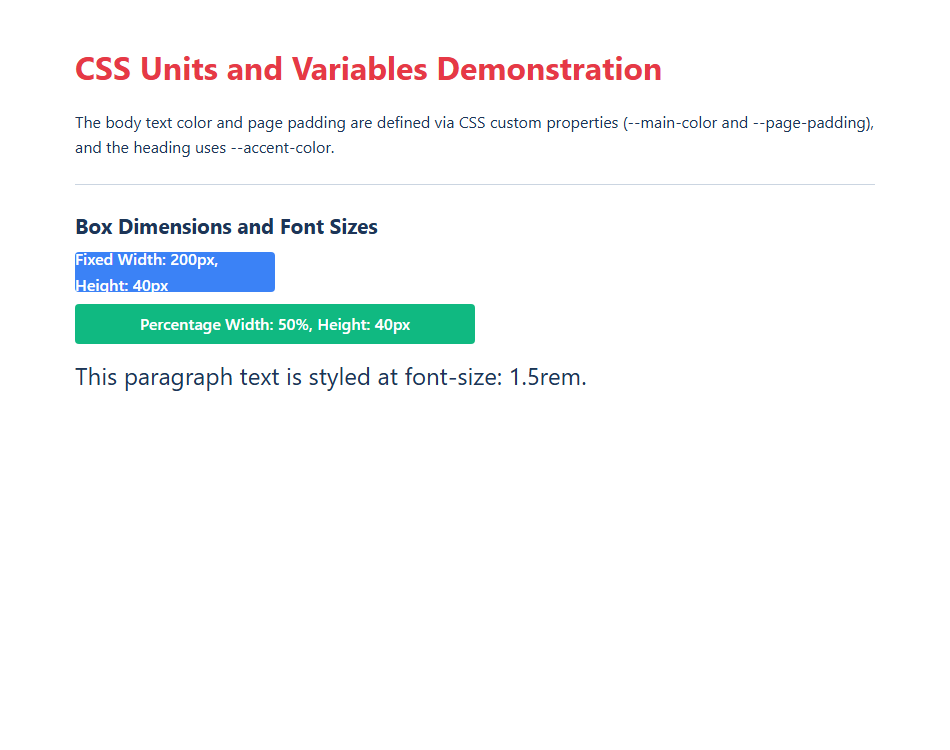

# EXPERIMENT NO. 11

## 1. Experiment Title
Units and CSS Variables

## 2. Aim
Use CSS units and store colours and spacing in variables.

## 3. Software / Tools Required
- Operating System: Windows 10/11
- Tools: Web Browser (Chrome / Edge), VS Code / Notepad

## 4. Theory
- **CSS Units:**
  - `px`: Fixed absolute pixel unit.
  - `%`: Relative unit based on the parent element's width.
  - `rem`: Relative unit based on the root (`<html>`) font size (typically 1rem = 16px).
- **CSS Variables (Custom Properties):**
  - Declared inside `:root` with `--name: value;` for global access.
  - Applied using `var(--name)`.
  - Makes changing colors and spacing across a site fast and easy.

## 5. Algorithm / Procedure
1. Create a box with fixed width 200px and height 40px with a background color.
2. Create a second box with width 50% and height 40px with a background color.
3. Add a paragraph styled with `font-size: 1.5rem`.
4. Define CSS variables in `:root`: `--main-color`, `--accent-color`, and `--page-padding`.
5. Use `var()` to apply these variables to the body padding, text color, and heading color.
6. Test in the browser and resize window to see percentage box adjust.

## 6. Program / Queries / Commands
```css
:root {
  --main-color: #1d3557;
  --accent-color: #e63946;
  --page-padding: 20px;
}

body {
  color: var(--main-color);
  padding: var(--page-padding);
}

h1 {
  color: var(--accent-color);
}

.box-fixed {
  width: 200px;
  height: 40px;
}

.box-percent {
  width: 50%;
  height: 40px;
}
```

## 7. Input
Dimensions: 200px, 50%, 1.5rem. Variables: --main-color, --accent-color, --page-padding.

## 8. Output
Browser display showing fixed vs fluid boxes, scalable rem text, and cohesive variable-driven colors.



## 9. Result
Absolute (px), relative (%, rem) units and reusable CSS variables were implemented successfully.

## 10. Viva-Voce Questions
1. **How does rem differ from em?**  
   *Answer:* rem is always relative to the root <html> font size, while em is relative to the immediate parent font size.

2. **Why are CSS variables defined inside :root?**  
   *Answer:* :root represents the highest parent element (<html>), making variables accessible across the entire document.

3. **When is a percentage unit useful?**  
   *Answer:* When designing responsive layouts that need to adapt fluidly to different screen sizes.
