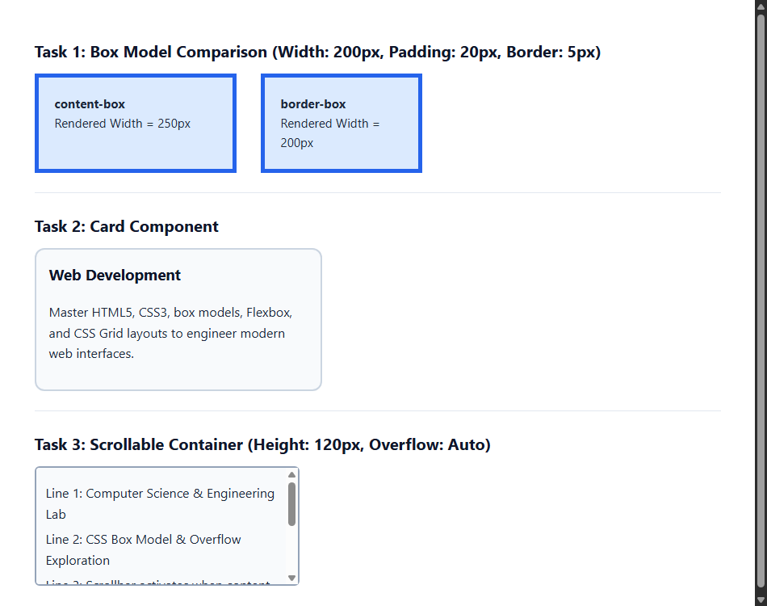

# EXPERIMENT NO. 12

## 1. Experiment Title
Box Model, Cards and Scrolling

## 2. Aim
Compare the box sizing types, style a card and make a box scroll.

## 3. Software / Tools Required
- Operating System: Windows 10/11
- Tools: Web Browser (Chrome / Edge), VS Code / Notepad

## 4. Theory
- **CSS Box Model:** Every element consists of Content, Padding, Border, and Margin.
- **box-sizing Modes:**
  - `content-box`: Default. Padding and border add to the declared width (200px width + 40px padding + 10px border = 250px total).
  - `border-box`: Width includes padding and border. Declared 200px stays exactly 200px.
- **Card Component:** Uses borders, rounded corners (`border-radius`), and padding to organize content into a card.
- **Scrolling (`overflow: auto`):** Adds scrollbars when content exceeds a container's fixed height.

## 5. Algorithm / Procedure
1. Create two boxes with `width: 200px`, `padding: 20px`, and `border: 5px`. Set `box-sizing: content-box` on one and `border-box` on the other to compare total widths.
2. Create a `.card` div with rounded corners (`border-radius: 12px`), 2px border, and 16px padding containing a heading and paragraph.
3. Create a box with fixed height 120px and `overflow: auto` containing 5 text lines to enable scrolling.
4. View the page in the browser to compare box widths and test scrolling.

## 6. Program / Queries / Commands
```css
/* Box model comparison */
.content-box {
  box-sizing: content-box; /* total width = 250px */
}
.border-box {
  box-sizing: border-box;  /* total width = 200px */
}

/* Card */
.card {
  border: 2px solid #cbd5e1;
  border-radius: 12px;
  padding: 16px;
}

/* Scroll box */
.scroll-box {
  height: 120px;
  overflow: auto;
}
```

## 7. Input
Width 200px, padding 20px, border 5px, border-radius 12px, height 120px with overflow: auto.

## 8. Output
Browser display showing the wider content-box vs compact border-box, a styled card, and an active scrollbox.



## 9. Result
Box sizing modes were compared, a rounded card component was styled, and overflow scrolling was demonstrated.

## 10. Viva-Voce Questions
1. **Why is box-sizing: border-box widely used in CSS resets?**  
   *Answer:* It makes sizing intuitive because padding and borders do not expand the overall width of elements.

2. **What does overflow: auto do?**  
   *Answer:* It automatically provides scrollbars only when content exceeds the container boundaries.

3. **What are the four components of the CSS box model?**  
   *Answer:* Content, padding, border, and margin.
