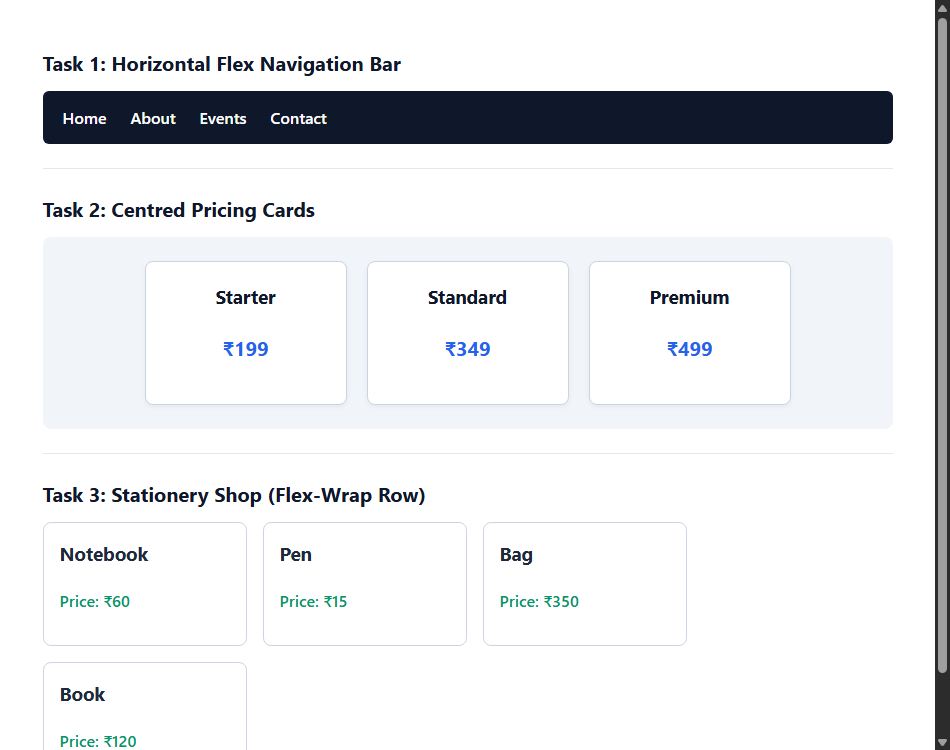

# EXPERIMENT NO. 13

## 1. Experiment Title
Flexbox Layouts

## 2. Aim
Lay out a navigation bar, centred cards and cards that wrap, using Flexbox.

## 3. Software / Tools Required
- Operating System: Windows 10/11
- Tools: Web Browser (Chrome / Edge), VS Code / Notepad

## 4. Theory
Flexbox is a one-dimensional layout model used to align items in rows or columns.
- `display: flex`: Enables flex container mode.
- `justify-content`: Aligns items horizontally along the main axis (`center`, `space-between`, etc.).
- `align-items`: Aligns items vertically across the cross axis (`center`, `stretch`).
- `flex-wrap: wrap`: Allows items to wrap onto the next line if they do not fit in a single row.

## 5. Algorithm / Procedure
1. Create a `<nav>` bar with 4 links (Home, About, Events, Contact). Apply `display: flex`, dark background, and white link text.
2. Create a row holding 3 pricing cards. Use `justify-content: center` and `align-items: center` to center the cards.
3. Create a stationery shop section with 4 product cards. Use `flex-wrap: wrap` so cards wrap onto new lines on narrow screens.
4. Save and narrow the browser window to test card wrapping.

## 6. Program / Queries / Commands
```css
/* 1. Flex Navbar */
nav {
  display: flex;
  background-color: #0f172a;
  padding: 14px 20px;
}

/* 2. Centered Cards */
.row {
  display: flex;
  justify-content: center;
  align-items: center;
  gap: 20px;
}

/* 3. Wrapping Cards */
.wrapping-row {
  display: flex;
  flex-wrap: wrap;
  gap: 16px;
}
```

## 7. Input
Nav links, pricing cards (Starter, Standard, Premium), stationery cards with prices.

## 8. Output
Browser display showing a horizontal navbar, centered cards, and cards wrapping cleanly on resize.



## 9. Result
Flexbox navigation, bidirectional item centering, and responsive wrapping rows were implemented.

## 10. Viva-Voce Questions
1. **What is the default direction of Flexbox?**  
   *Answer:* row (items are laid out horizontally from left to right).

2. **What does justify-content: center do?**  
   *Answer:* It centers flex items along the main horizontal axis.

3. **What happens when flex-wrap: wrap is applied?**  
   *Answer:* Items that exceed container width automatically drop onto the next row.
