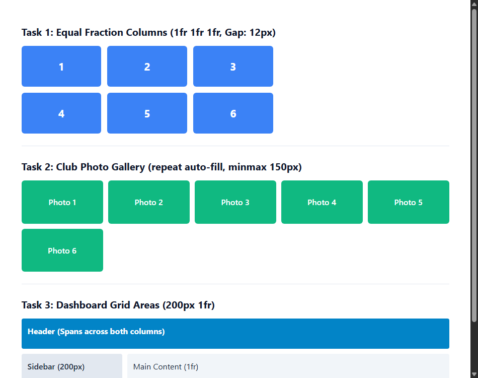

# EXPERIMENT NO. 14

## 1. Experiment Title
CSS Grid Layouts

## 2. Aim
Make a grid with equal columns, a responsive gallery and a layout with named areas.

## 3. Software / Tools Required
- Operating System: Windows 10/11
- Tools: Web Browser (Chrome / Edge), VS Code / Notepad

## 4. Theory
CSS Grid is a two-dimensional layout system that handles both columns and rows.
- `display: grid`: Defines a grid container.
- `1fr` (Fraction unit): Distributes available space equally among columns.
- `repeat(auto-fill, minmax(150px, 1fr))`: Automatically fits as many responsive columns as possible without media queries.
- `grid-template-areas`: Positions header, sidebar, main, and footer using visual named area strings.

## 5. Algorithm / Procedure
1. Create a 3-column grid with `grid-template-columns: 1fr 1fr 1fr` and `gap: 12px` holding 6 numbered boxes.
2. Create a photo gallery with `repeat(auto-fill, minmax(150px, 1fr))` holding 6 photo boxes.
3. Create a dashboard layout with two columns (200px and 1fr) using `grid-template-areas` for header, sidebar, main, and footer.
4. Save and resize the browser window to see the gallery columns adapt dynamically.

## 6. Program / Queries / Commands
```css
/* 1. Equal 3 Columns */
.grid-numbers {
  display: grid;
  grid-template-columns: 1fr 1fr 1fr;
  gap: 12px;
}

/* 2. Responsive Gallery */
.gallery-grid {
  display: grid;
  grid-template-columns: repeat(auto-fill, minmax(150px, 1fr));
  gap: 10px;
}

/* 3. Dashboard Areas */
.dashboard-grid {
  display: grid;
  grid-template-columns: 200px 1fr;
  grid-template-areas:
    "header header"
    "sidebar main"
    "footer footer";
  gap: 10px;
}
```

## 7. Input
6 numbered boxes, 6 gallery boxes, 4 dashboard sections (header, sidebar, main, footer).

## 8. Output
Browser display showing equal fraction columns, fluid auto-fitting gallery, and a clean structured dashboard.



## 9. Result
Equal fraction columns, fluid responsive galleries, and named template areas were built using CSS Grid.

## 10. Viva-Voce Questions
1. **How does CSS Grid differ from Flexbox?**  
   *Answer:* CSS Grid works in two dimensions (columns and rows simultaneously), while Flexbox is primarily one-dimensional.

2. **What does the fr unit stand for?**  
   *Answer:* Fraction of available space within the grid container.

3. **How does repeat(auto-fill, minmax(150px, 1fr)) work?**  
   *Answer:* It creates as many columns as will fit, each at least 150px wide, expanding equally to fill empty space.
