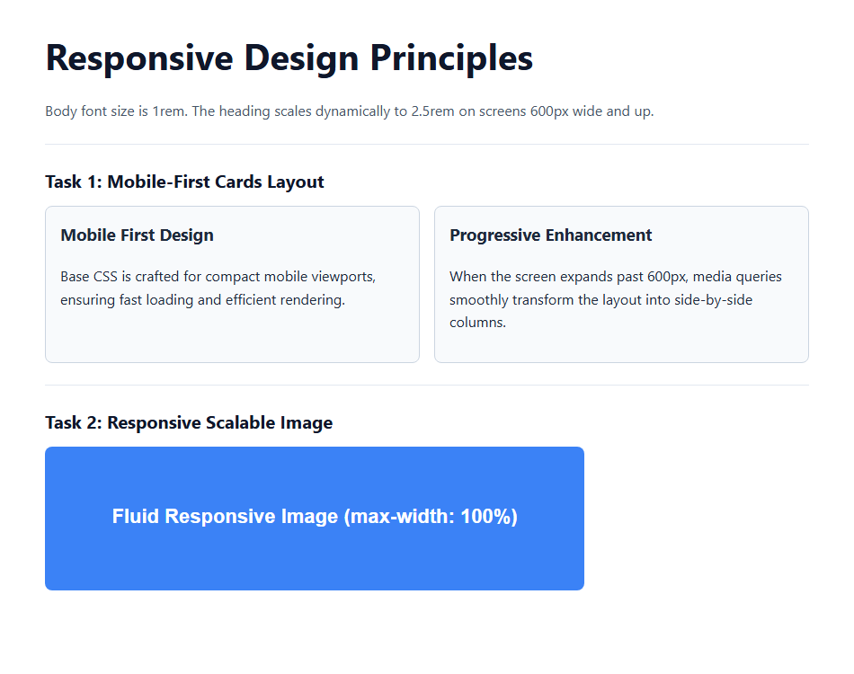

# EXPERIMENT NO. 15

## 1. Experiment Title
Responsive Pages with Media Queries

## 2. Aim
Use a media query to change a layout, make a picture scale with its box, and set text sizes with rem units.

## 3. Software / Tools Required
- Operating System: Windows 10/11
- Tools: Web Browser (Chrome / Edge), VS Code / Notepad

## 4. Theory
- **Viewport Meta Tag:** Sets the page width to follow the device screen size (`width=device-width, initial-scale=1.0`).
- **Mobile-First Approach:** Write base styles for small screens first, then use `@media (min-width: 600px)` to add desktop features.
- **Fluid Scalable Images:** `max-width: 100%` and `height: auto` ensure images shrink to fit smaller screens without distortion.
- **Responsive Typography:** Adjusting heading font size with `rem` units inside media queries for optimal readability.

## 5. Algorithm / Procedure
1. Add the viewport meta tag inside `<head>`.
2. Create two cards inside a `.cards` container. Set base CSS to stack cards in a column.
3. Add a media query for `min-width: 600px` that displays cards side-by-side in a row.
4. Add an image with `max-width: 100%` and `height: auto` so it resizes fluidly.
5. Set body font size to 1rem and heading to 1.5rem, scaling the heading to 2.5rem at `min-width: 600px`.
6. Test in the browser and resize window across 600px breakpoint.

## 6. Program / Queries / Commands
```css
/* Base styles (Mobile-First) */
body {
  font-size: 1rem;
}
h1 {
  font-size: 1.5rem;
}
.cards {
  display: flex;
  flex-direction: column;
  gap: 16px;
}
img {
  max-width: 100%;
  height: auto;
}

/* Tablet / Desktop view (>= 600px) */
@media (min-width: 600px) {
  h1 {
    font-size: 2.5rem;
  }
  .cards {
    flex-direction: row;
  }
  .card {
    flex: 1;
  }
}
```

## 7. Input
Viewport meta tag, cards container, fluid image, breakpoint @media (min-width: 600px).

## 8. Output
Browser display showing stacked cards on mobile expanding to side-by-side columns and larger heading on desktop.



## 9. Result
Mobile-first layout switching, fluid image scaling, and responsive typography were implemented successfully.

## 10. Viva-Voce Questions
1. **What is the purpose of the viewport meta tag?**  
   *Answer:* It ensures the webpage renders at the native device width without artificial mobile scaling.

2. **What is the mobile-first design strategy?**  
   *Answer:* Designing for smaller mobile screens first and progressively enhancing the layout for larger viewports.

3. **How does max-width: 100% make an image responsive?**  
   *Answer:* It allows the image to scale down to fit narrower containers while preventing it from overflowing.
