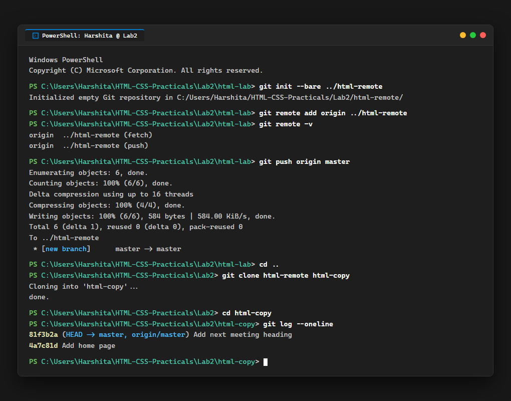

# EXPERIMENT NO. 02

## 1. Experiment Title
Pushing and Cloning a Repository

## 2. Aim
Send your commits to a second repository on your computer and make a copy of it with clone.

## 3. Software / Tools Required
- Operating System: Windows 10/11
- Tools: Git, PowerShell / Terminal, VS Code

## 4. Theory
- **Bare Repository:** A repository created with `git init --bare` that contains only Git history without a working directory. It acts as a central remote.
- **Remote Origin:** A shortcut name given to the remote repository URL or path.
- **git push:** Uploads local branch commits to the remote repository.
- **git clone:** Copies an entire remote repository into a new folder on your computer.

## 5. Algorithm / Procedure
1. Inside `html-lab`, create a bare repository named `html-remote` using `git init --bare ../html-remote`.
2. Add it as origin with `git remote add origin ../html-remote` and check with `git remote -v`.
3. Push your commits to origin using `git push origin master`.
4. Go up one folder (`cd ..`) and clone `html-remote` into a new folder named `html-copy` using `git clone html-remote html-copy`.
5. Enter `html-copy` and run `git log --oneline` to verify the commits.

## 6. Program / Queries / Commands
```bash
# 1. Create bare remote and link it
git init --bare ../html-remote
git remote add origin ../html-remote
git remote -v

# 2. Push commits to remote
git push origin master

# 3. Clone to new folder and verify
cd ..
git clone html-remote html-copy
cd html-copy
git log --oneline
```

## 7. Input
Bare repo: ../html-remote, Clone destination: html-copy.

## 8. Output
Terminal output displaying remote configuration, successful push to master, and clone log verification.



## 9. Result
The bare repository was created, commits were pushed successfully, and cloned into html-copy with full commit history.

## 10. Viva-Voce Questions
1. **What is a bare Git repository?**  
   *Answer:* A repository without a working directory, used as a central hub for pushing and pulling changes.

2. **What does git remote -v display?**  
   *Answer:* It lists all configured remote names along with their fetch and push locations.

3. **What does git clone do?**  
   *Answer:* It creates a complete copy of an existing remote repository into a new local directory.
