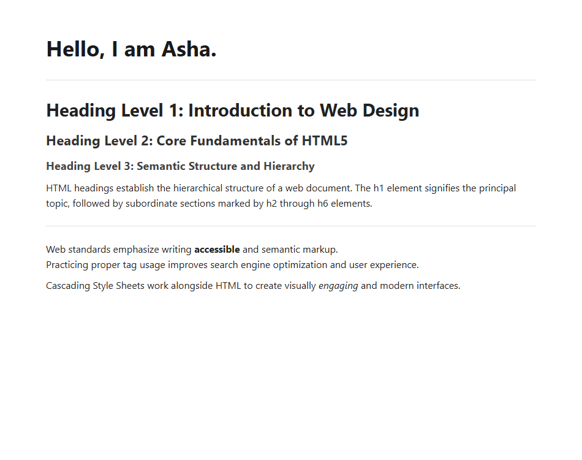

# EXPERIMENT NO. 03

## 1. Experiment Title
Your First HTML Page

## 2. Aim
Write a first HTML page with a title, headings and a paragraph, and format some text.

## 3. Software / Tools Required
- Operating System: Windows 10/11
- Tools: Web Browser (Chrome / Edge), VS Code / Notepad

## 4. Theory
- **HTML Document Structure:** Starts with `<!DOCTYPE html>` followed by `<html>`, `<head>`, and `<body>`.
- **Title (`<title>`):** Sets the text shown on the browser tab.
- **Headings (`<h1>` to `<h6>`):** Define titles and subtitles in order of importance.
- **Paragraph (`<p>`):** Defines a block of regular text.
- **Text Formatting:**
  - `<strong>`: Makes text bold to show importance.
  - `<em>`: Makes text italic to show emphasis.
  - `<br>`: Inserts a line break inside text.

## 5. Algorithm / Procedure
1. Create an HTML file with basic structure and set title to "My First Page".
2. Add an `<h1>` heading with text "Hello, I am Asha."
3. Add heading levels `<h1>`, `<h2>`, `<h3>` followed by a paragraph.
4. Add another paragraph using `<strong>` on one word, `<em>` on another word, and a `<br>` line break.
5. Save the file and view the output in a web browser.

## 6. Program / Queries / Commands
```html
<!DOCTYPE html>
<html lang="en">
<head>
  <meta charset="UTF-8">
  <title>My First Page</title>
</head>
<body>
  <h1>Hello, I am Asha.</h1>
  
  <h2>Heading Level 2</h2>
  <h3>Heading Level 3</h3>
  <p>HTML headings create clear content hierarchy.</p>
  
  <p>Learn <strong>HTML5</strong> markup.<br>
  It makes web pages <em>accessible</em> and clean.</p>
</body>
</html>
```

## 7. Input
Headings text, paragraphs, strong and em tags, line break.

## 8. Output
Browser display showing heading hierarchy, formatted bold/italic words, and clean paragraph text.



## 9. Result
The HTML page was created and rendered correctly with proper title, headings, and text formatting.

## 10. Viva-Voce Questions
1. **What is the role of <!DOCTYPE html>?**  
   *Answer:* It informs the browser that the document is written in HTML5 standard mode.

2. **How does <strong> differ from <b>?**  
   *Answer:* <strong> has semantic meaning indicating strong importance, while <b> only applies visual bold styling.

3. **What does the <br> tag do?**  
   *Answer:* It creates an inline line break without creating a new paragraph block.
