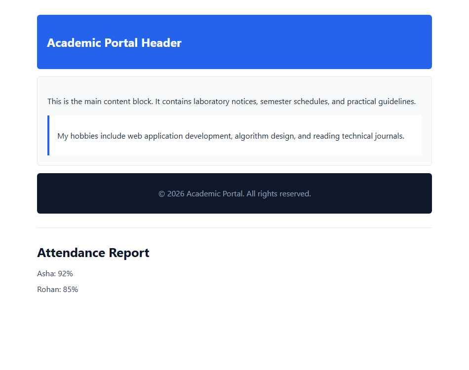

# EXPERIMENT NO. 04

## 1. Experiment Title
Divs, Attributes and a Small Fix

## 2. Aim
Group parts of a page with div elements, add a data attribute, and fix the errors in a broken page.

## 3. Software / Tools Required
- Operating System: Windows 10/11
- Tools: Web Browser (Chrome / Edge), VS Code / Notepad

## 4. Theory
- **<div> Tag:** A generic block container used to group elements together for styling and layout.
- **Classes and IDs:**
  - `class`: Reusable label applied to one or more elements (e.g. `.header`, `.main`, `.footer`).
  - `id`: A unique identifier for a single specific element (e.g. `#profile`).
- **Data Attributes (`data-*`):** Stores custom extra data inside HTML elements without changing how the page looks.
- **HTML Validation:** Proper closing tags prevent browser display glitches.

## 5. Algorithm / Procedure
1. Create three `<div>` blocks with classes `header`, `main`, and `footer` with sample text.
2. Inside a div with `id="profile"`, add a paragraph with the attribute `data-topic="hobbies"`.
3. Fix syntax errors in the broken attendance code (unclosed `<h1>` and mismatched `<p>` tags).
4. Save and test the page in the browser.

## 6. Program / Queries / Commands
```html
<!-- Layout with divs -->
<div class="header"><h2>Header</h2></div>
<div class="main">
  <div id="profile">
    <p data-topic="hobbies">My hobbies include coding and reading.</p>
  </div>
</div>
<div class="footer"><p>&copy; 2026 Portal</p></div>

<!-- Corrected attendance report -->
<h1>Attendance Report</h1>
<p>Asha: 92%</p>
<p>Rohan: 85%</p>
```

## 7. Input
Div containers, id="profile", data-topic="hobbies", attendance data.

## 8. Output
Browser output showing organized header, main, and footer sections and clean attendance text.



## 9. Result
Page layout was organized with divs, custom data attribute was added, and broken HTML was fixed.

## 10. Viva-Voce Questions
1. **What is a <div> element used for?**  
   *Answer:* It is a generic block container used to group elements together for styling and structure.

2. **What is the purpose of data-* attributes?**  
   *Answer:* They store custom data directly in HTML tags for use by CSS or JavaScript.

3. **Why is it important to close HTML tags properly?**  
   *Answer:* Unclosed tags can cause layout breaks and inconsistent rendering across browsers.
