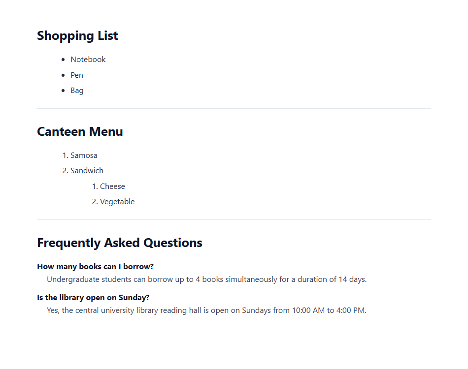

# EXPERIMENT NO. 06

## 1. Experiment Title
Types of HTML Lists

## 2. Aim
Make a bulleted list, a numbered list with a nested list, and a description list.

## 3. Software / Tools Required
- Operating System: Windows 10/11
- Tools: Web Browser (Chrome / Edge), VS Code / Notepad

## 4. Theory
- **Unordered List (`<ul>`):** Displays items in bullet points using `<li>`.
- **Ordered List (`<ol>`):** Displays items in numbered order (1, 2, 3...) using `<li>`.
- **Nested List:** Placing a list inside another list item to create sub-items.
- **Description List (`<dl>`):** Displays terms (`<dt>`) and their definitions/descriptions (`<dd>`).

## 5. Algorithm / Procedure
1. Create an unordered list (`<ul>`) under "Shopping List" with Notebook, Pen, and Bag.
2. Create a numbered list (`<ol>`) under "Canteen Menu" with Samosa and Sandwich. Under Sandwich, nest a numbered list with Cheese and Vegetable.
3. Create a description list (`<dl>`) under "Frequently Asked Questions" with two questions in `<dt>` and answers in `<dd>`.
4. Save and inspect list bullets, numbers, and indentation in the browser.

## 6. Program / Queries / Commands
```html
<!-- Unordered List -->
<h1>Shopping List</h1>
<ul>
  <li>Notebook</li>
  <li>Pen</li>
  <li>Bag</li>
</ul>

<!-- Ordered & Nested List -->
<h1>Canteen Menu</h1>
<ol>
  <li>Samosa</li>
  <li>Sandwich
    <ol>
      <li>Cheese</li>
      <li>Vegetable</li>
    </ol>
  </li>
</ol>

<!-- Description List -->
<h1>Frequently Asked Questions</h1>
<dl>
  <dt>How many books can I borrow?</dt>
  <dd>Up to 4 books for 14 days.</dd>
  <dt>Is the library open on Sunday?</dt>
  <dd>Yes, open from 10:00 AM to 4:00 PM.</dd>
</dl>
```

## 7. Input
Shopping items, menu items with nested sub-items, FAQ questions and answers.

## 8. Output
Browser display showing clean bulleted, nested numbered, and description lists.



## 9. Result
All three HTML list types were created and structured properly according to HTML standards.

## 10. Viva-Voce Questions
1. **What is the main difference between <ul> and <ol>?**  
   *Answer:* <ul> creates bulleted items where order does not matter, while <ol> creates numbered sequential items.

2. **Where should a nested list be placed?**  
   *Answer:* Inside an <li> element of the parent list.

3. **What tags are used in a description list?**  
   *Answer:* <dl> for the list container, <dt> for terms, and <dd> for descriptions.
