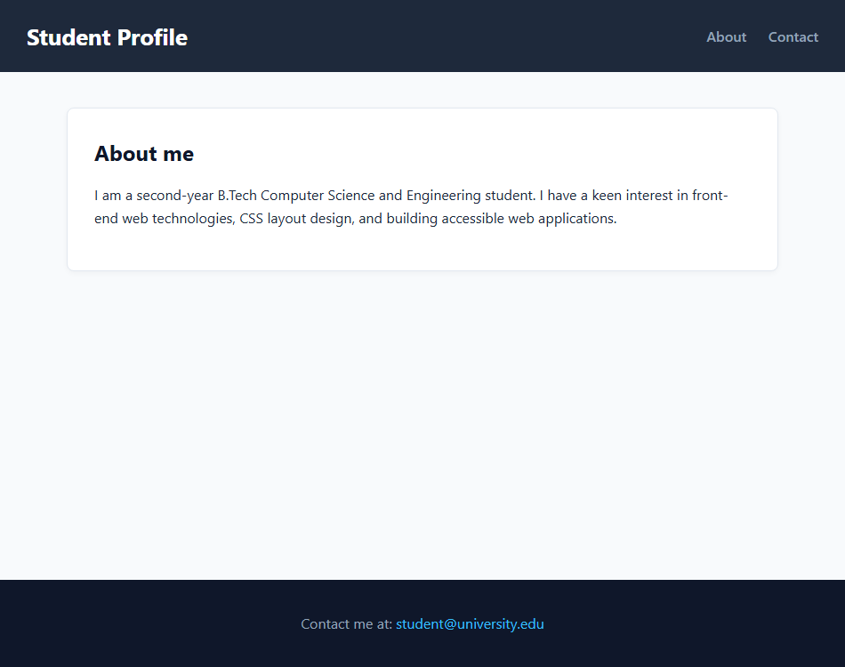

# EXPERIMENT NO. 07

## 1. Experiment Title
About Me Page

## 2. Aim
Build a short About Me page with semantic tags, an about section and a contact link.

## 3. Software / Tools Required
- Operating System: Windows 10/11
- Tools: Web Browser (Chrome / Edge), VS Code / Notepad

## 4. Theory
- **Semantic Elements:** Tags that clearly describe their purpose to browsers and developers:
  - `<header>`: Top container for titles and navigation.
  - `<nav>`: Container for major navigation links.
  - `<main>`: Holds the central, unique content of the page.
  - `<section>`: Standalone thematic section.
  - `<footer>`: Bottom container for contact info and copyright.
- **Bookmark Link (`#id`):** Scrolls the page directly to an element with that ID.
- **Mailto Link (`mailto:`):** Opens the user's default email app with the email address pre-filled.

## 5. Algorithm / Procedure
1. Create an HTML file using semantic tags: `<header>`, `<main>`, and `<footer>`.
2. In the header, add an `<h1>` name and a `<nav>` with links to `#about` and `#contact`.
3. In main, create `<section id="about">` with heading "About me" and a short paragraph.
4. In footer, set `id="contact"` and add a paragraph with a `mailto:` email link.
5. Save and verify that clicking the top nav links jumps to the matching sections.

## 6. Program / Queries / Commands
```html
<header>
  <h1>Student Profile</h1>
  <nav>
    <a href="#about">About</a>
    <a href="#contact">Contact</a>
  </nav>
</header>

<main>
  <section id="about">
    <h2>About me</h2>
    <p>I am a second-year B.Tech CSE student learning web technologies.</p>
  </section>
</main>

<footer id="contact">
  <p>Contact: <a href="mailto:harshita.upadhyay@invertis.org">harshita.upadhyay@invertis.org</a></p>
</footer>
```

## 7. Input
Semantic layout tags, #about and #contact anchors, mailto email link.

## 8. Output
Browser display showing a clean semantic layout with working navigation and contact link.



## 9. Result
The semantic About Me page was built successfully with functioning bookmark and mailto links.

## 10. Viva-Voce Questions
1. **Why are semantic HTML tags preferred over <div>?**  
   *Answer:* They provide meaning to screen readers and search engines, improving accessibility and SEO.

2. **How does an href="#id" link work?**  
   *Answer:* It scrolls the browser viewport directly to the element with that specific id.

3. **What does a mailto: link do when clicked?**  
   *Answer:* It opens the user default email client to compose a new message.
