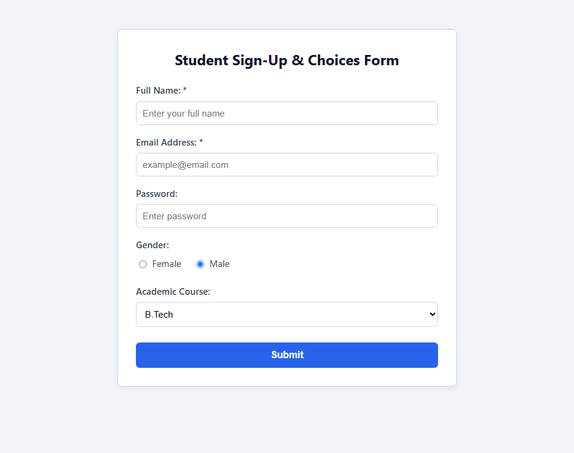

# EXPERIMENT NO. 08

## 1. Experiment Title
Sign-Up Forms and Choices

## 2. Aim
Make a labelled form with text, email and password fields, choices and a submit button.

## 3. Software / Tools Required
- Operating System: Windows 10/11
- Tools: Web Browser (Chrome / Edge), VS Code / Notepad

## 4. Theory
- **Form (`<form>`):** Container used to collect user input.
- **Form Controls:**
  - `<input type="text">`: Single-line text input.
  - `<input type="email">`: Input validated for email format.
  - `<input type="password">`: Input that masks entered characters.
  - `<input type="radio">`: Option buttons where only one option can be chosen.
  - `<select>` & `<option>`: Dropdown list for selecting options.
- **Labels (`<label>`):** `<label for="id">` links the label text to its input field.
- **Validation:** `required` forces users to fill a field before submitting.

## 5. Algorithm / Procedure
1. Create a form with fields for Full Name, Email, and Password.
2. Link each `<label>` to its input using the `for` and `id` attributes.
3. Add gender radio buttons (Female, Male) sharing the same `name` attribute.
4. Add an academic course dropdown with options BCA and B.Tech.
5. Add `required` validation to the name and email fields, and include a Submit button.
6. Test in the browser to verify input masking, radio exclusivity, and validation messages.

## 6. Program / Queries / Commands
```html
<form action="#" method="post">
  <div>
    <label for="name">Full Name: *</label>
    <input type="text" id="name" placeholder="Enter full name" required>
  </div>
  <div>
    <label for="email">Email: *</label>
    <input type="email" id="email" placeholder="Enter email" required>
  </div>
  <div>
    <label for="pass">Password:</label>
    <input type="password" id="pass">
  </div>
  <div>
    <label><input type="radio" name="gender" value="Female"> Female</label>
    <label><input type="radio" name="gender" value="Male" checked> Male</label>
  </div>
  <div>
    <label for="course">Course:</label>
    <select id="course">
      <option>BCA</option>
      <option selected>B.Tech</option>
    </select>
  </div>
  <button type="submit">Submit</button>
</form>
```

## 7. Input
Name, email, password, gender radio buttons, course select dropdown.

## 8. Output
Browser display showing styled input fields, masked password, radio choices, dropdown, and submit button.



## 9. Result
The interactive form was created with labelled inputs, choices, and client-side validation.

## 10. Viva-Voce Questions
1. **Why should every input have a linked label?**  
   *Answer:* It improves accessibility for screen readers and allows clicking the label to focus the input.

2. **How do you make radio buttons mutually exclusive?**  
   *Answer:* By giving all radio buttons in the group the same name attribute.

3. **What does the required attribute do in an input tag?**  
   *Answer:* It prevents the form from submitting if the field is left empty.
