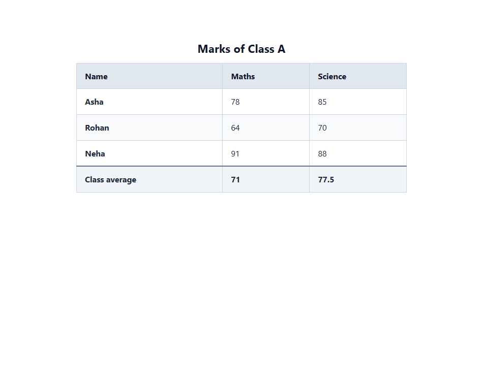

# EXPERIMENT NO. 09

## 1. Experiment Title
Tables with Headers and Footers

## 2. Aim
Build a table with a caption, a header, rows and a footer, and add scope attributes.

## 3. Software / Tools Required
- Operating System: Windows 10/11
- Tools: Web Browser (Chrome / Edge), VS Code / Notepad

## 4. Theory
- **Table Structure:**
  - `<table>`: Container for tabular data.
  - `<caption>`: Title or description of the table.
  - `<thead>`: Holds the header row (`<th>`).
  - `<tbody>`: Holds the main student data rows (`<td>`).
  - `<tfoot>`: Holds summary or average rows.
- **Scope Attribute:**
  - `scope="col"`: Indicates the header applies to a whole column.
  - `scope="row"`: Indicates the header applies to a whole row.

## 5. Algorithm / Procedure
1. Create a table with caption "Marks of Class A".
2. Add a `<thead>` section with column headers: Name, Maths, Science.
3. Add a `<tbody>` section with student marks for Asha (78, 85), Rohan (64, 70), and Neha (91, 88).
4. Add a `<tfoot>` section with a "Class average" row (Maths: 71, Science: 77.5).
5. Add `scope="col"` to column headers and `scope="row"` to row headers for accessibility.
6. Save and view the styled table in the browser.

## 6. Program / Queries / Commands
```html
<table border="1">
  <caption>Marks of Class A</caption>
  <thead>
    <tr>
      <th scope="col">Name</th>
      <th scope="col">Maths</th>
      <th scope="col">Science</th>
    </tr>
  </thead>
  <tbody>
    <tr>
      <th scope="row">Asha</th>
      <td>78</td>
      <td>85</td>
    </tr>
    <tr>
      <th scope="row">Rohan</th>
      <td>64</td>
      <td>70</td>
    </tr>
    <tr>
      <th scope="row">Neha</th>
      <td>91</td>
      <td>88</td>
    </tr>
  </tbody>
  <tfoot>
    <tr>
      <th scope="row">Class average</th>
      <td>71</td>
      <td>77.5</td>
    </tr>
  </tfoot>
</table>
```

## 7. Input
Student marks data, class averages, accessibility scope attributes.

## 8. Output
Browser display showing a clear table with caption, highlighted header row, data rows, and summary footer.



## 9. Result
The accessible HTML table was built with captions, header, body, footer, and scope attributes.

## 10. Viva-Voce Questions
1. **What is the purpose of the <thead>, <tbody>, and <tfoot> tags?**  
   *Answer:* They divide the table into semantic sections, making it easier to style and print multi-page tables.

2. **What does the scope attribute do on a <th> cell?**  
   *Answer:* It specifies whether the header cell applies to a column (scope="col") or a row (scope="row") for screen readers.

3. **How does <th> differ from <td>?**  
   *Answer:* <th> represents a header cell (bold and centered by default), while <td> represents regular data.
